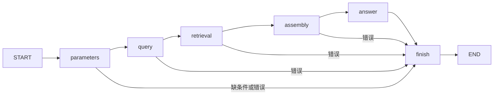

# T08 状态图

T08-01 的混合图保留原接口；提供 router 参数时启用 T08-02 的三路线图。路由和查询参数由原始模型输出，程序检查后执行。

| 节点 | 读取与写入 |
| --- | --- |
| parameters | 读取 question，写回放、时刻或序号和统计指标 |
| query | 使用取参结果，写实际 game_loop、tool_calls、tool_result |
| retrieval | 读取指标名，写 retrieval_query、notes |
| assembly | 合并问题与两类证据，写 evidence、answer_prompt |
| answer | 使用提示和预算，写模型响应、状态或错误 |
| finish | 记录已执行节点，对缺条件返回 clarify 和 message |

前五个节点使用 T06 的共享 Runnable。调用入口为 `invoke_session(graph, store, session_id, question)`，从 T07 读取会话编号和历史。

## 三类路线

| route | 实际路径 |
| --- | --- |
| numeric | route → query → assembly → answer → finish |
| explanation | route → retrieval → assembly → answer → finish |
| mixed | route → query → retrieval → assembly → answer → finish |

路由 JSON 包含 route、replay_id、sample_ordinal、game_loop、metric。程序检查结构、类型和允许值，并核对用户明确给出的回放与时刻。解释题无需回放，数字题缺条件时返回 clarify，非法路由返回 error。当前问题支持单一指标。条件继承、待补问题恢复和统一调用预算将在后续步骤接入。

`src/routing.py` 复用真实查询函数、T04 数值提示、T05 说明提示和 T06 混合组装。分别注入 router 和 generate，后续替换回答模型时保持 router 指向原始模型。混合题使用两类来源校验，其他路线保留原文供人工核对。
## 补充条件与取消

`invoke_session` 在返回 clarify 时保存当前问题到会话的 pending_question，本轮结束于 END。下轮将补充内容与原问题合并，从 route 重新进入新图状态，重新查询证据。回放或时刻冲突时返回澄清，保留待处理问题。输入「取消」「取消旧问题」「取消当前问题」会清空待处理问题，无需调用模型。新会话和换局时的待处理问题为空。运行记录包含有效问题、用户原始输入、会话前后状态。
