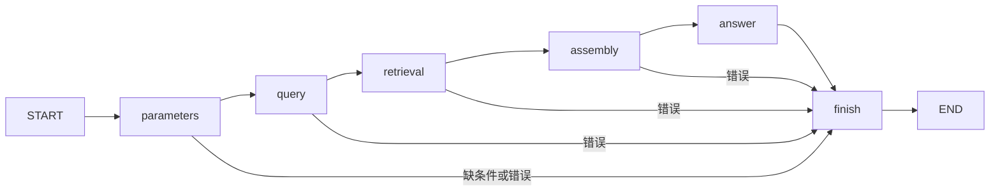

# T08 状态图

当前实现 T08-01，接收条件明确的混合问题；缺条件时结束本轮并返回澄清提示。

| 节点 | 读取与写入 |
| --- | --- |
| parameters | 读取 question，写回放、时刻或序号和统计指标 |
| query | 使用取参结果，写实际 game_loop、tool_calls、tool_result |
| retrieval | 读取指标名，写 retrieval_query、notes |
| assembly | 合并问题与两类证据，写 evidence、answer_prompt |
| answer | 使用提示和预算，写模型响应、状态或错误 |
| finish | 记录已执行节点，对缺条件返回 clarify 和 message |

前五个节点使用 T06 的共享 Runnable，T06 固定链继续使用相同组件。每步保留输入输出，条件边在错误后转向 finish。调用入口为 `invoke_session(graph, store, session_id, question)`，从 T07 读取会话编号和历史。本阶段处理完整单轮问题，三路线、条件继承、待补问题恢复和统一预算将在后续步骤接入。
